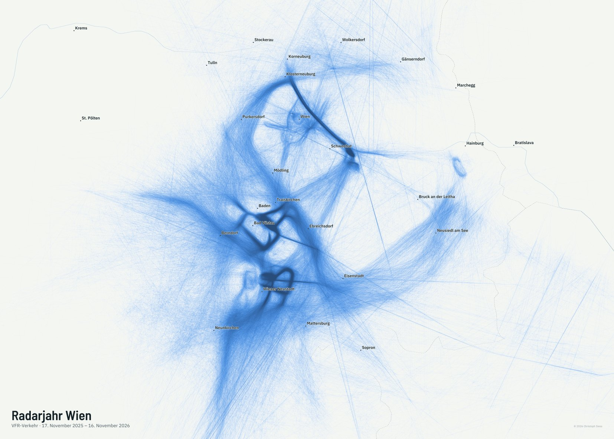
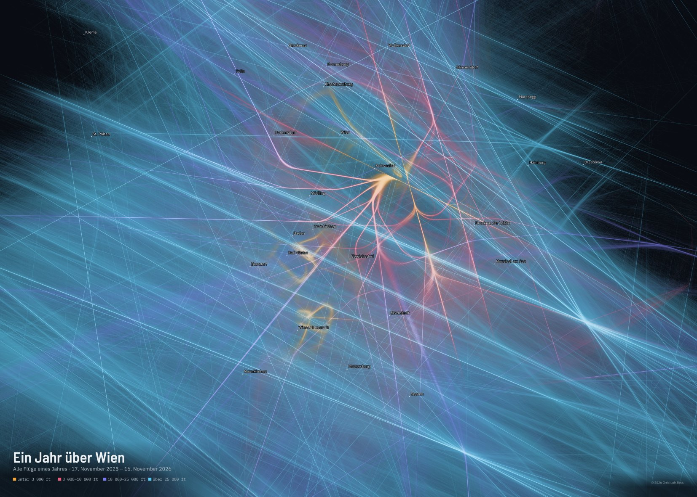
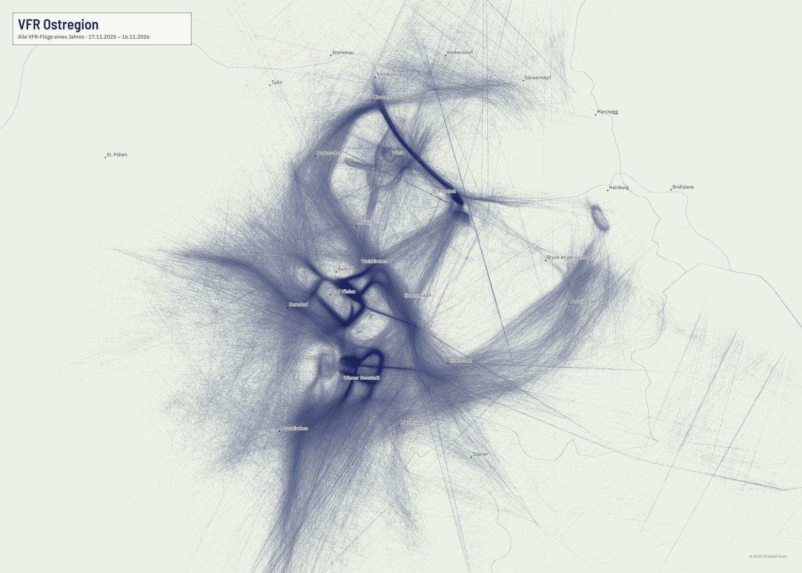
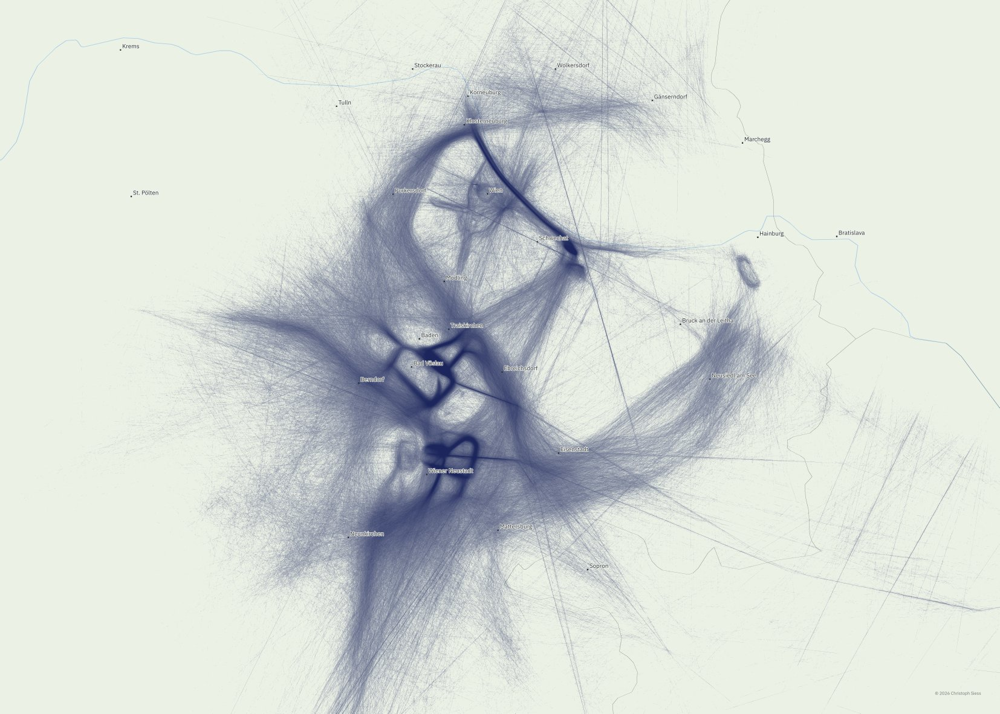

# Radarjahr Wien – Poster zum Selberbestellen

Ein Jahr Flugverkehr rund um Wien, aufgezeichnet mit einem eigenen
ADS-B-Radarempfänger (17. November 2025 – 16. November 2026),
als Poster für den IKEA-Rahmen RÖDALM 70 × 100 cm.

Drei Motive (eines davon auch ohne Titel), jedes in zwei Größen. Datei herunterladen, bei einem
Posterdienst hochladen, fertig.

---

## Die Motive

### Radarjahr Wien

Heller Kartenhintergrund, Sichtflugverkehr (VFR) in Blautönen – je dunkler,
desto mehr Flüge im Jahr. Gut zu sehen: die Platzrunden in Bad Vöslau und
Wiener Neustadt, die Donau-Route bei Klosterneuburg, der Flughafen Schwechat.

### Ein Jahr über Wien

Dunkler Hintergrund, alle Flüge, eingefärbt nach Flughöhe:
orange unter 3 000 ft · rosa 3 000–10 000 ft · violett 10 000–25 000 ft · hellblau über 25 000 ft.

### VFR Ostregion

Im Stil einer Luftfahrtkarte: alle Sichtflüge als dunkelblaue Linien
auf hellem Papierton, mit Flüssen, Seen und Grenzen.

**Variante ohne Titel:** dasselbe Motiv ohne den Textblock links oben –
nur Karte, für alle, die es ruhiger mögen.

---

## Welche Größe nehme ich?

Beide Größen passen in **denselben Rahmen**:
[IKEA RÖDALM, 70 × 100 cm](https://www.ikea.com/at/en/p/roedalm-frame-oak-effect-70566405/)
(Schwarz, Weiß, Eiche, Birke oder Walnuss). Den Rahmen quer aufhängen.

| | **Groß – ohne Passepartout** | **Klein – mit Passepartout** |
|---|---|---|
| So sieht's aus | Bild füllt den ganzen Rahmen | weißer Rand rund ums Bild |
| Postergröße bestellen | **100 × 70 cm** | **70 × 50 cm** |
| Passepartout | herausnehmen | im Rahmen lassen |
| Kosten Druck | höher | niedriger |

## Downloads

| Motiv | Groß (100 × 70 cm) | Klein (70 × 50 cm) |
|---|---|---|
| Radarjahr Wien | [herunterladen](https://github.com/csiess85/radarjahr-wien/releases/latest/download/Radarjahr-Wien_100x70cm_ohne-Passepartout_300dpi.png) | [herunterladen](https://github.com/csiess85/radarjahr-wien/releases/latest/download/Radarjahr-Wien_70x50cm_mit-Passepartout_300dpi.png) |
| Ein Jahr über Wien | [herunterladen](https://github.com/csiess85/radarjahr-wien/releases/latest/download/Ein-Jahr-ueber-Wien_100x70cm_ohne-Passepartout_300dpi.png) | [herunterladen](https://github.com/csiess85/radarjahr-wien/releases/latest/download/Ein-Jahr-ueber-Wien_70x50cm_mit-Passepartout_300dpi.png) |
| VFR Ostregion | [herunterladen](https://github.com/csiess85/radarjahr-wien/releases/latest/download/VFR-Ostregion_100x70cm_ohne-Passepartout_300dpi.png) | [herunterladen](https://github.com/csiess85/radarjahr-wien/releases/latest/download/VFR-Ostregion_70x50cm_mit-Passepartout_300dpi.png) |
| VFR Ostregion – ohne Titel | [herunterladen](https://github.com/csiess85/radarjahr-wien/releases/latest/download/VFR-Ostregion-ohne-Titel_100x70cm_ohne-Passepartout_300dpi.png) | [herunterladen](https://github.com/csiess85/radarjahr-wien/releases/latest/download/VFR-Ostregion-ohne-Titel_70x50cm_mit-Passepartout_300dpi.png) |

Die Dateien sind groß (bis über 100 MB) – der Download kann etwas dauern.

---

## So bestellst du dein Poster

1. **Datei herunterladen** – Motiv und Größe aus der Tabelle oben.
2. **Posterdienst öffnen** – z. B. ein Online-Fotolabor oder der Posterdruck
   deiner Drogerie. Wichtig ist nur, dass es die Größe **100 × 70 cm** bzw.
   **70 × 50 cm** gibt.
3. **Format „Poster" wählen**, Größe wie oben, **Querformat**.
4. **Datei hochladen.** Wenn der Dienst fragt:
   - **ohne weißen Rand / randlos** wählen
   - **nicht zuschneiden, nicht „an Seite anpassen"** – die Datei hat schon genau die richtige Größe
   - Papier: **matt** oder **seidenmatt** sieht im Rahmen am besten aus (glänzend spiegelt hinter der Rahmenscheibe)
5. **Bestellen.** Eine Warnung zur Auflösung sollte nicht kommen –
   die Dateien haben volle 300 dpi.
6. **Rahmen:** RÖDALM 70 × 100 cm bei IKEA. Beim großen Poster das
   Passepartout herausnehmen, beim kleinen drinlassen.

Tipp: Lade die Datei am besten am Computer hoch, nicht am Handy –
manche Apps verkleinern große Bilder beim Hochladen.

---

## Über die Daten

Die Flugbahnen stammen aus einem eigenen ADS-B-Empfänger in der Region Wien.
Gezeigt wird, wie viele verschiedene Flüge im Lauf des Jahres über jeden
Punkt der Karte geflogen sind. Flugzeuge ohne ADS-B-Sender oder mit
schlechtem Empfang fehlen.

Kartengrundlage (Grenzen, Flüsse, Seen): © [OpenStreetMap-Mitwirkende](https://www.openstreetmap.org/copyright).

---

## Lizenz

© 2026 Christoph Siess – die Poster stehen unter
[CC BY-NC 4.0](https://creativecommons.org/licenses/by-nc/4.0/deed.de).

Das heißt: Du darfst die Poster **für dich drucken, aufhängen, weitergeben
und auch verändern** – solange du den Urheber nennst und es **nicht
kommerziell** ist. Poster verkaufen oder die Motive für Produkte nutzen
ist nicht erlaubt. Für dich selbst bei einem Druckdienst bestellen ist
natürlich in Ordnung. Der Copyright-Vermerk unten rechts im Bild reicht als
Namensnennung, also bitte nicht wegschneiden.
